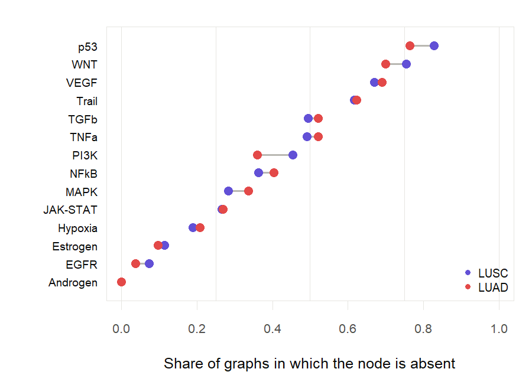
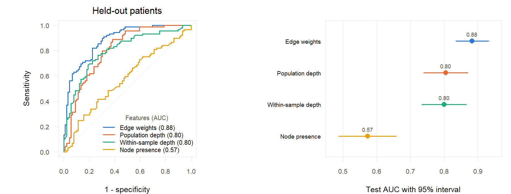
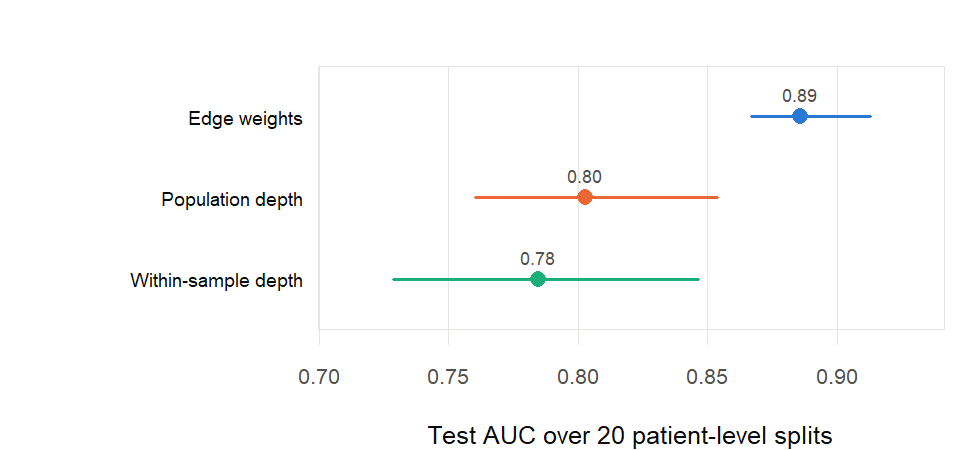
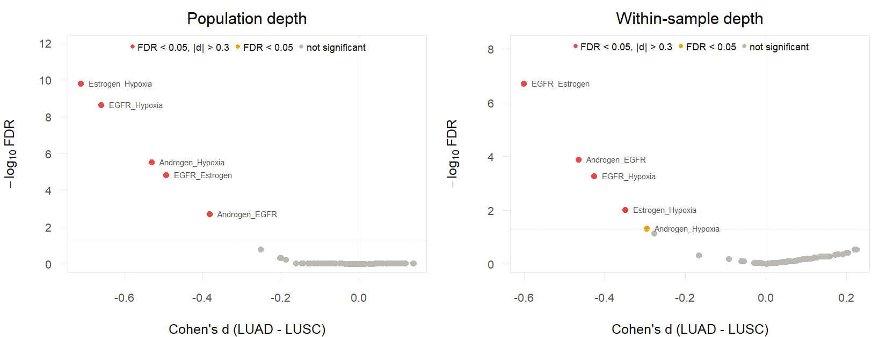
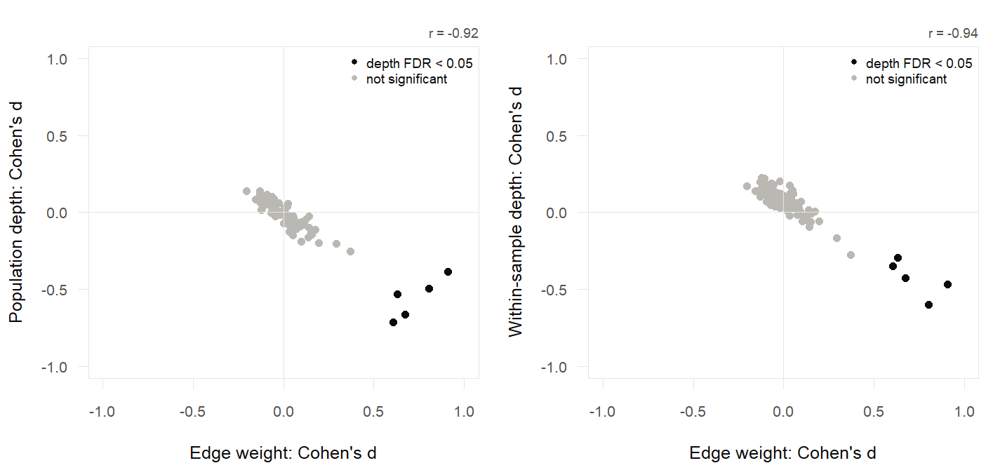
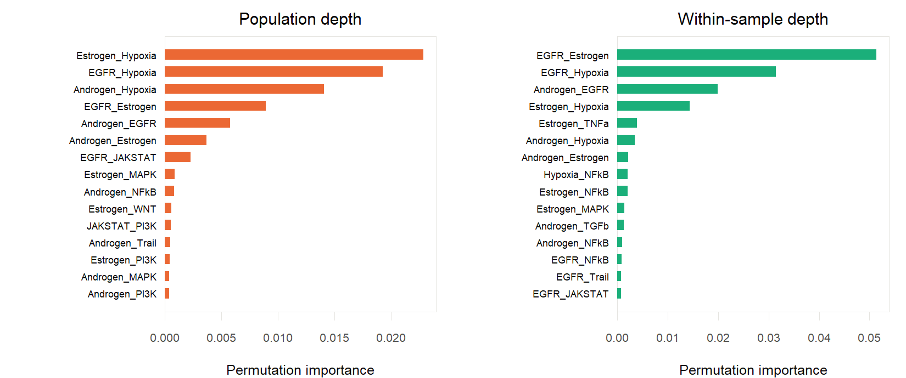
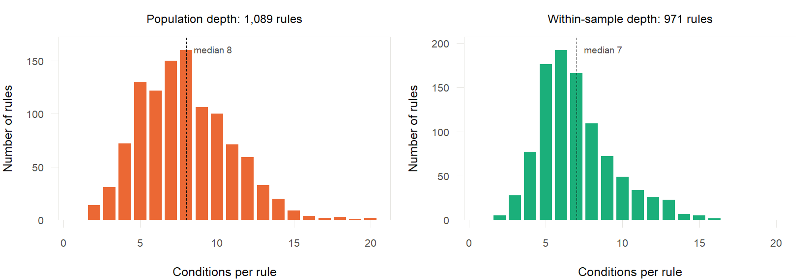
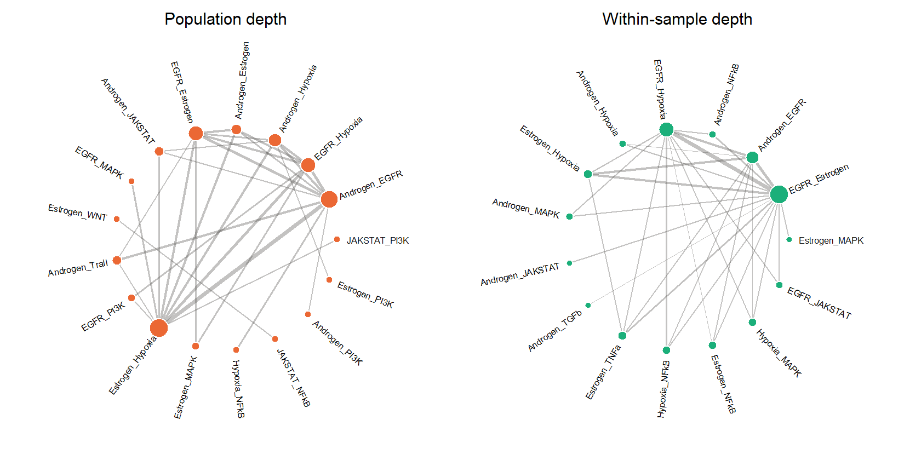

# pathwaydepth

[](https://doi.org/10.5281/zenodo.24324732)

Depth features for small weighted graphs, with the tools to classify two
groups of graphs, evaluate the classifiers honestly, and see what the features
mean. The package accompanies

> Bhadury S, Tsang AP, Ray D, Lagisetty K, Rao A. Functional depth features of spatial
> pathway graphs from histology-predicted transcriptomics in lung
> adenocarcinoma and squamous cell carcinoma. Revised manuscript, 2026.

In that article each tumour slide is summarised by a graph on 14 signalling
pathways, and the 91 edge weights measure how close the spots dominated by one
pathway lie to the spots dominated by another. The package works for any
collection of small weighted graphs with a two-class label.

## Installation

```r
# install.packages("remotes")
remotes::install_github("sagnikbhadury/pathwaydepth")
```

## What the package does

Each graph is a vector of edge weights. The package turns every edge weight
into a depth, a number in [0, 1] that says how central the weight is in a
reference distribution, under two reference frames:

| Function | Reference distribution for edge *j* of graph *i* |
|---|---|
| `population_depth()` | edge *j* across the training graphs |
| `within_depth()` | all edges of graph *i* |

The depth is `2 * min(F(x), 1 - F(x))`, the Fraiman and Muniz univariate depth
rescaled to the unit interval. It is one at the median of the reference
distribution and falls to zero in both tails. **It is unsigned**: a very high
and a very low edge weight get the same depth. `within_rank()` is the signed
version of the within-sample feature.

| Step | Functions |
|---|---|
| Read or simulate graphs | `read_graphs()`, `simulate_graphs()` |
| Edge weights and node presence | `complete_graph()`, `edge_matrix()`, `presence_matrix()` |
| Depth features | `population_depth()`, `within_depth()`, `within_rank()` |
| Split by patient | `grouped_split()` |
| Classify | `fit_forest()`, `predict_forest()` |
| Evaluate and compare | `evaluate()`, `compare_auc()` |
| Compare groups edge by edge | `compare_groups()` |
| Decision rules | `extract_rules()`, `rule_membership()`, `cooccurrence()` |
| Figures | `plot_presence()`, `plot_roc()`, `plot_intervals()`, `plot_volcano()`, `plot_depth_vs_weight()`, `plot_importance()`, `plot_rule_lengths()`, `plot_cooccurrence()` |

## A complete analysis on simulated graphs

The walkthrough below runs the whole analysis of the article on simulated
graphs and shows every figure the package produces. The data are random
numbers from `simulate_graphs()`: two classes (labelled LUSC and LUAD only so
that the output looks like the article's), 14 nodes that are absent from a
slide at random, and six edges whose mean weight is doubled in the second
class. **The results illustrate the package. They are not results about lung
cancer.** The full script is `inst/examples/walkthrough.R`.

### 1. Data

```r
library(pathwaydepth)

sim <- simulate_graphs(660, seed = 2026)      # 660 slides; some patients have two
keep    <- sim$slides$primary                 # one slide per patient
graphs  <- sim$graphs[keep, , ]               # slides x 14 x 14 directed proximity
y       <- sim$slides$subtype[keep]
patient <- sim$slides$patient[keep]

plot_presence(graphs, y)
```

A node can be absent from a graph (an all-zero row and column). The first
thing to look at is how often that happens, and whether it differs between the
classes, because absence alone can carry class information.



### 2. Edge weights, a patient-level split, and the depth features

```r
x <- edge_matrix(graphs)                      # slides x 91 edge weights

set.seed(1)
train <- grouped_split(patient, y, p = 0.7)   # patients, not slides, are split

features <- list(
  "Edge weights"        = list(train = x[train, ], test = x[!train, ]),
  "Population depth"    = list(train = population_depth(x[train, ], x[train, ]),
                               test  = population_depth(x[!train, ], x[train, ])),
  "Within-sample depth" = list(train = within_depth(x[train, ]),
                               test  = within_depth(x[!train, ])),
  "Node presence"       = list(train = presence_matrix(graphs[train, , ]) + 0,
                               test  = presence_matrix(graphs[!train, , ]) + 0))
```

`grouped_split()` keeps all slides of a patient on the same side. Test graphs
are scored against the training graphs only (`population_depth(new, reference)`),
so nothing leaks from the test set. The edge weights and the node presence
indicators are included as baselines: a depth feature is worth using only if
it does at least as well as the weights it was computed from.

### 3. Classification, intervals and a paired comparison

```r
fits  <- lapply(features, function(f) fit_forest(f$train, y[train], seed = 1))
probs <- mapply(function(fit, f) predict_forest(fit, f$test), fits, features,
                SIMPLIFY = FALSE)
evals <- mapply(function(p, fit) evaluate(p, y[!train], fit$threshold),
                probs, fits, SIMPLIFY = FALSE)

evals[["Within-sample depth"]]
#>        metric  estimate     lower     upper
#> 1         AUC 0.7995203 0.7338137 0.8652268
#> 2    Accuracy 0.7415730 0.6707479 0.8041670
#> 3 Sensitivity 0.7528090 0.6500076 0.8381478
#> 4 Specificity 0.7303371 0.6258267 0.8189680

compare_auc(probs[["Within-sample depth"]], probs[["Population depth"]], y[!train])
#>        auc1      auc2   difference       lower      upper   p_value
#> 1 0.7995203 0.8041914 -0.004671127 -0.08586049 0.07651824 0.9102176

plot_roc(probs, y[!train], main = "Held-out patients")
auc <- function(col) sapply(evals, function(e) e[e$metric == "AUC", col])
plot_intervals(auc("estimate"), auc("lower"), auc("upper"),
               xlab = "Test AUC with 95% interval")
```

`fit_forest()` tunes a random forest on out-of-bag predictions and sets the
classification threshold on them as well, so the test labels are used once.
`evaluate()` returns each metric with a confidence interval, and
`compare_auc()` tests two classifiers on the same test cases (DeLong).



Here the two depth representations cannot be told apart (difference -0.005,
p = 0.91), and both are below the edge weights.

### 4. Repeated splits

One split is one draw. Repeating the split shows how much the result depends
on which patients were held out.

```r
w_all <- within_depth(x)                      # does not depend on the split
res <- t(sapply(1:20, function(r) {
  set.seed(100 + r)
  tr <- grouped_split(patient, y, p = 0.7)
  f <- list("Edge weights"        = list(x[tr, ], x[!tr, ]),
            "Population depth"    = list(population_depth(x[tr, ], x[tr, ], B = 0),
                                         population_depth(x[!tr, ], x[tr, ], B = 0)),
            "Within-sample depth" = list(w_all[tr, ], w_all[!tr, ]))
  sapply(f, function(z) {
    fit <- fit_forest(z[[1]], y[tr], num_trees = 500, tune_trees = 200, seed = r)
    evaluate(predict_forest(fit, z[[2]]), y[!tr], fit$threshold)$estimate[1]
  })
}))
plot_intervals(colMeans(res), apply(res, 2, quantile, 0.025),
               apply(res, 2, quantile, 0.975),
               xlab = "Test AUC over 20 patient-level splits")
```



### 5. Which edges differ between the classes

```r
cmp_weight <- compare_groups(features[["Edge weights"]]$train, y[train])
cmp_pop    <- compare_groups(features[["Population depth"]]$train, y[train])
cmp_within <- compare_groups(features[["Within-sample depth"]]$train, y[train])

head(cmp_weight, 5)
#>            feature mean_LUSC mean_LUAD         d      p_value          fdr
#> 1    Androgen_EGFR  2.357457  4.749763 0.9098980 2.238216e-18 2.036777e-16
#> 2    EGFR_Estrogen  8.798840 22.205375 0.8044709 9.250516e-15 4.208985e-13
#> 3     EGFR_Hypoxia  8.779906 22.952389 0.6745471 4.681556e-11 1.420072e-09
#> 4 Androgen_Hypoxia  2.102473  4.001043 0.6309291 4.030422e-10 9.169211e-09
#> 5 Estrogen_Hypoxia  3.224078  6.372659 0.6066070 1.972443e-09 3.589847e-08

plot_volcano(cmp_pop, main = "Population depth")
plot_volcano(cmp_within, main = "Within-sample depth")
```

`compare_groups()` runs Welch's t-test on every feature of the training set,
with Cohen's d (second class minus first) and Benjamini-Hochberg adjustment.
The comparison recovers the edges that were simulated to differ.



Note the direction. In the table the edge weights are **higher** in the second
class (d > 0), but in the volcano plots the depths of the same edges are
**lower** (d < 0). This is what an unsigned feature does: a weight that moves
further into the upper tail of its reference distribution becomes less
central. Always read a depth difference next to the edge-weight difference:

```r
plot_depth_vs_weight(cmp_pop, cmp_weight, ylab = "Population depth: Cohen's d")
plot_depth_vs_weight(cmp_within, cmp_weight, ylab = "Within-sample depth: Cohen's d")
```



### 6. Feature importance

```r
plot_importance(fits[["Population depth"]], top = 15, main = "Population depth")
plot_importance(fits[["Within-sample depth"]], top = 15, main = "Within-sample depth")
```



Importance and the group comparison are computed on the same training data.
Their agreement is a consistency check, not an independent confirmation.

### 7. Decision rules and their co-occurrence

```r
rules <- list(
  "Population depth"    = extract_rules(fits[["Population depth"]], trees = 1:20),
  "Within-sample depth" = extract_rules(fits[["Within-sample depth"]], trees = 1:20))

# every case satisfies exactly one rule of a tree
r1 <- rules[[2]][rules[[2]]$tree == 1, ]
all(rule_membership(r1, features[["Within-sample depth"]]$train) == 1)
#> [1] TRUE

head(rules[[2]][order(rules[[2]]$n_conditions), c("rule", "prediction")], 3)
#>                                                 rule prediction
#> 245  EGFR_Estrogen <= 0.0416667 & EGFR_NFkB <= 0.125       LUSC
#> 329 Androgen_EGFR <= 0.645833 & Hypoxia_MAPK > 0.875       LUAD
#> 500   EGFR_Hypoxia <= 0.0416667 & NFkB_TGFb <= 0.125       LUSC

plot_rule_lengths(rules)
```

`extract_rules()` lists every root-to-leaf path of the chosen trees by
depth-first traversal. Thresholds are kept at full precision (columns `lower`
and `upper`), so the rules reproduce the trees exactly; the text in `rule` is
rounded for reading.



```r
co <- lapply(rules, cooccurrence)
head(co[[2]]$nodes, 5)
#>             feature degree total rules
#> 14    EGFR_Estrogen     89  4222   679
#> 15     EGFR_Hypoxia     87  3252   529
#> 1     Androgen_EGFR     84  2579   415
#> 26 Estrogen_Hypoxia     80  1823   302
#> 33    Estrogen_TNFa     77  1297   193

plot_cooccurrence(co[[1]], top = 30, main = "Population depth")
plot_cooccurrence(co[[2]], top = 30, main = "Within-sample depth")
```



Two cautions about rules. A forest grown to purity gives long rules that each
cover a handful of cases, so a single rule is not a stable signature. And a
feature that is split near the root of a tree is on every rule of that tree,
so the hubs of the co-occurrence network are mostly the features the forest
uses most: in this example the correlation between a feature's co-occurrence
total and the number of rules that use it is 0.98
(`cor(co[[2]]$nodes$total, co[[2]]$nodes$rules, method = "spearman")`). Use the
network as a picture of the forest, not as evidence beyond importance.

## Using your own graphs

`read_graphs(graph_dir, annotation)` reads one CSV file per slide (a square
matrix with the node names in the first row and column, named `<slide>.csv`)
and an annotation file with the columns `pat` (slide identifier) and `disease`
(class label). It returns the same list as `simulate_graphs()`, so the
walkthrough above runs unchanged.

## Data

This repository contains code only. The spatial pathway graphs analysed in the
article (one 14 x 14 directed G-cross proximity matrix for each of 996
diagnostic slides of TCGA-LUAD and TCGA-LUSC) are **not distributed**. They
are derived from the DeepSpot predicted spatial transcriptomics of TCGA slides
(Nonchev et al., 2025, doi:10.1101/2025.02.09.25321567), which is released
under CC BY-NC-ND 4.0, a licence that does not allow derivatives to be
distributed. The DeepSpot data can be requested from its authors at
<https://huggingface.co/datasets/nonchev/TCGA_digital_spatial_transcriptomics>.

## Reproducing the manuscript

The scripts are in `inst/analysis`. They need the graph files (see Data) and
write to an output folder of your choice.

```sh
Rscript inst/analysis/01_primary.R          results <folder of graph CSV files> <annotation CSV>
Rscript inst/analysis/02_repeated_splits.R  results primary 50
Rscript inst/analysis/02_repeated_splits.R  results all 50
Rscript inst/analysis/03_bulk_baselines.R   results <folder with GDC count files>
Rscript inst/analysis/04_rules_and_checks.R results
Rscript inst/analysis/05_figures.R          results figures
Rscript inst/analysis/06_original_figures.R results <figure script> figures_original
```

Script 03 needs the STAR gene counts of TCGA-LUAD and TCGA-LUSC from the
Genomic Data Commons; they are not redistributed here.

## Citation

Bhadury S, Tsang AP, Rao A. pathwaydepth: Depth Features for Spatial Pathway
Graphs (version 0.1.0). Zenodo, 2026. https://doi.org/10.5281/zenodo.24324732

## Licence

MIT.
